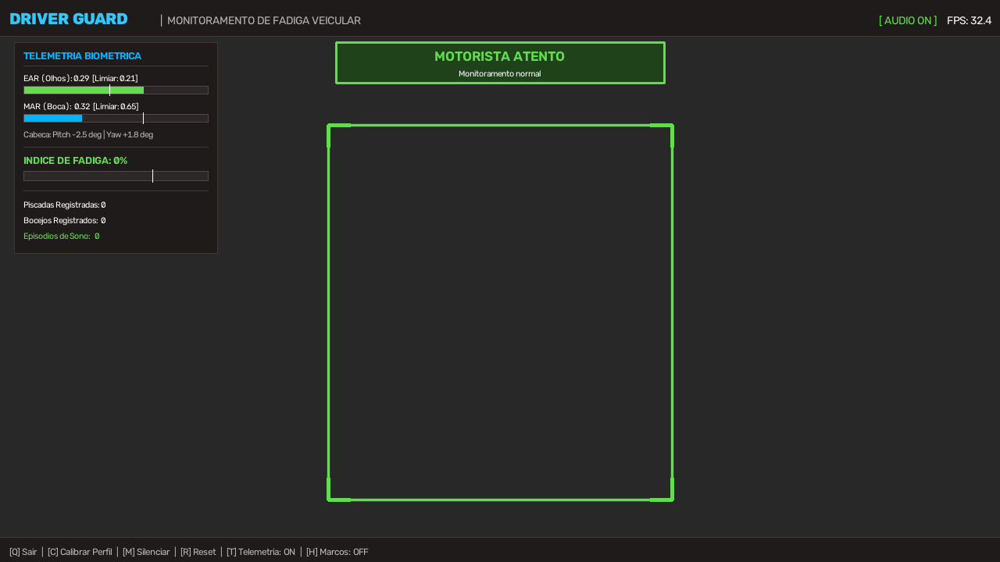
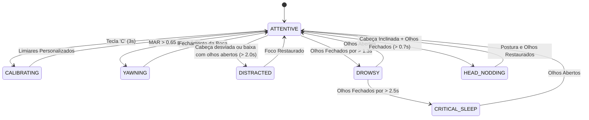

# DriverGuard DMS - Sistema de Monitoramento e Reconhecimento de Fadiga Veicular

Sistema em tempo real para monitoramento do condutor veicular (**Driver Monitoring System - DMS**), desenvolvido em Python com técnicas de visão computacional e biometria facial para detecção de sonolência, micro-sonos, bocejos e distração ao volante, emitindo alertas audiovisuais imediatos.



---

## 📌 Visão Geral

Sistemas de monitoramento de condutores (DMS) são componentes fundamentais da segurança ativa automotiva moderna (ADAS). O **DriverGuard DMS** monitora continuamente o comportamento do motorista através da webcam ou fluxo de vídeo, analisando métricas biométricas dos olhos, boca e orientação tridimensional da cabeça para detectar precocemente sinais de exaustão e sonolência ao volante.

### Principais Características
- **Detecção de Sonolência em Tempo Real:** Cálculo contínuo da Razão de Aspecto do Olho (*Eye Aspect Ratio - EAR*) para detecção de piscadas lentas e micro-sonos.
- **Detecção de Bocejos:** Cálculo da Razão de Aspecto da Boca (*Mouth Aspect Ratio - MAR*) com filtro temporal para identificar bocejos genuínos.
- **Estimativa de Pose da Cabeça 3D:** Cálculo dos ângulos de Euler (*Pitch, Yaw e Roll*) para identificar tombamento de cabeça (cochilo) e desvio de atenção da via.
- **Calibração Biométrica Adaptativa:** Permite que o motorista calibre os limiares matemáticos em 3 segundos, adaptando o software à sua geometria facial individual.
- **Interface Heads-Up Display (HUD):** Painel gráfico com telemetria em tempo real, barras de progresso dinâmicas e aviso de emergência com borda piscante.
- **Sistema de Alertas Não-Bloqueante:** Emissão de alertas sonoros automotivos em threads separadas, mantendo a taxa de quadros (FPS) estável e suave.
- **Sintetizador Autônomo de Áudio:** Gera internamente seus próprios arquivos de som de alerta via síntese senoidal (WAV), sem dependências de codecs externos.

---

## 🛠️ Tecnologias Utilizadas

- **Linguagem:** Python 3.12
- **Visão Computacional & Biometria:** Google MediaPipe (FaceLandmarker com 478 marcos faciais 3D)
- **Processamento de Imagem:** OpenCV 5 (com suporte a captura de baixa latência DirectShow)
- **Cálculo Vetorial & Álgebra Linear:** NumPy e SciPy
- **Áudio do Sistema:** Módulo nativo `winsound` e gerador senoidal WAV autônomo

---

## 📐 Fundamentos Biométricos e Algoritmos

### 1. Razão de Aspecto do Olho (EAR - Eye Aspect Ratio)
Baseado no modelo proposto por *Soukupová e Čech (2016)*, o EAR quantifica o grau de abertura palpebral calculando a relação entre as distâncias verticais e a distância horizontal do olho:

$$\text{EAR} = \frac{\|p_2 - p_6\| + \|p_3 - p_5\|}{2 \cdot \|p_1 - p_4\|}$$

- **Olhos Abertos:** EAR situa-se tipicamente entre `0.28` e `0.35`.
- **Olhos Fechados:** EAR sofre queda brusca para valores inferiores a `0.21`.
- **Confirmação Dupla:** Além da distância geométrica, o sistema monitora as ativações de contração palpebral do FaceLandmarker para eliminar falsos positivos.

### 2. Razão de Aspecto da Boca (MAR - Mouth Aspect Ratio)
Utilizado para monitorar a amplitude de abertura dos lábios internos:

$$\text{MAR} = \frac{\|p_{sup\_esq} - p_{inf\_esq}\| + \|p_{sup\_mid} - p_{inf\_mid}\| + \|p_{sup\_dir} - p_{inf\_dir}\|}{2 \cdot \|p_{esq} - p_{dir}\|}$$

- Se $\text{MAR} > 0.65$ por um período sustentado (> 1.8s), o software registra um bocejo e eleva o índice progressivo de fadiga.

### 3. Estimativa de Pose da Cabeça (Head Pose 3D) & Fusão Multi-Modal
A orientação tridimensional e a razão de compressão de perspectiva 2D são monitoradas:
- **Pitch 3D & Razão de Perspectiva:** Identifica cabeça inclinada para baixo (`Pitch < -8.0°` ou `Ratio < 0.55`).
- **Fusão Multi-Modal de Segurança:** A cabeça baixa isoladamente **não** dispara alerta de sono (permite consultar painel/marcha). O estado de **Cochilo ao Volante (`HEAD_NODDING`)** exige obrigatoriamente a combinação de **Cabeça Inclinada + Olhos Fechados** (> 0.7s).
- **Cabeça Baixa com Olhos Abertos:** Se breve (< 2.0s), considerado condução normal. Se prolongado (> 2.0s no celular/painel), aciona alerta de **Distração** (`DISTRACTED`).
- **Yaw (Rotação Horizontal):** Identifica desvio prolongado do olhar para fora da rota (`|Yaw| > 28°` por > 2.0s).

---

## 🚦 Estados Operacionais e Alertas



- 🟢 **MOTORISTA ATENTO:** Parâmetros biométricos normais.
- 🟡 **AVISO: BOCEJO PROLONGADO:** Sinal de sonolência inicial; tom suave e contagem estatística.
- 🟡 **ATENÇÃO: OLHOS NA VIA:** Cabeça virada lateralmente ou voltada para baixo com olhos abertos (> 2.0s).
- 🚨 **PERIGO: COCHILO AO VOLANTE:** Cabeça caída para frente + Olhos fechados (> 0.7s); aciona alarme sonoro contínuo e flash vermelho de emergência.
- 🔴 **ALERTA: SONOLÊNCIA DETECTADA:** Olhos fechados na postura ereta (> 1.3s); alarme sonoro pulsante.
- 🚨 **PERIGO CRÍTICO: MICRO-SONO:** Olhos fechados (> 2.5s); borda em vermelho intenso com alarme contínuo até o condutor acordar.

---

## 📁 Estrutura do Projeto

```text
Reconhecimento de sono/
├── config.py                 # Parâmetros de limiares, tempos de disparo e cores
├── main.py                   # Ponto de entrada, loop de execução e eventos de teclado
├── test_pipeline.py          # Suite de validação e testes de integração
├── requirements.txt          # Dependências do projeto
├── face_landmarker.task      # Modelo de marcos faciais do MediaPipe
├── assets/
│   ├── sample_hud_preview.png# Pré-visualização da interface gráfica
│   └── sounds/               # Arquivos de áudio WAV sintetizados
├── core/
│   ├── __init__.py
│   ├── metrics.py            # Implementação matemática de EAR, MAR e Ângulos de Euler
│   ├── face_detector.py      # Extração de marcos faciais 3D e blendshapes
│   ├── drowsiness_tracker.py # Máquina de estados (FSM), calibração e índice de fadiga
│   └── alert_system.py       # Gerenciador de alertas multithread e efeito de piscamento
└── ui/
    ├── __init__.py
    ├── audio_generator.py    # Gerador senoidal de frequências automotivas WAV
    └── hud.py                # Renderizador da interface Heads-Up Display
```

---

## 🚀 Instalação e Execução

### 1. Clonar o repositório e instalar dependências
```bash
pip install -r requirements.txt
```

### 2. Executar os testes de integração
```bash
python test_pipeline.py
```

### 3. Iniciar o sistema
```bash
python main.py
```

---

## ⌨️ Atalhos do Teclado

| Tecla | Ação | Descrição |
| :---: | :--- | :--- |
| **`C`** | **Calibração** | Inicia a auto-calibração de 3 segundos para ajustar os limiares ao seu rosto. |
| **`M`** | **Mute / Unmute** | Ativa ou desativa os alarmes sonoros em tempo real. |
| **`R`** | **Reset** | Zera os contadores de piscadas, bocejos e episódios de sono da sessão. |
| **`T`** | **Telemetria** | Oculta ou exibe o painel lateral de telemetria para deixar o campo de visão 100% desobstruído. |
| **`H`** | **Marcos Faciais** | Ativa ou oculta os contornos sobre olhos e boca (mantidos ocultos por padrão para deixar o rosto livre e desobstruído). |
| **`Q`** ou **`ESC`** | **Sair** | Encerra a aplicação e exibe o relatório da sessão no terminal. |

---

## ⚙️ Opções de Linha de Comando

```bash
# Executar utilizando webcam secundária
python main.py --camera 1

# Executar a partir de um arquivo de vídeo gravado
python main.py --video "caminho/do/video.mp4"

# Executar sem alertas sonoros
python main.py --no-sound

# Exibir telemetria em tempo real no terminal
python main.py --debug

# Configurar resolução customizada da janela
python main.py --width 1920 --height 1080
```

## 📱 Versão Web Mobile & Demonstração no Smartphone (PWA)

O projeto conta com uma versão completa em **WebAssembly + WebGL** na pasta [`web/`](file:///c:/Users/marci/Documents/Area%20de%20Testes/Reconehcimento%20de%20sono/web), projetada especificamente para smartphones (Android e iOS) e demonstradores portáteis.

### Destaques Mobile
- **Aceleração por GPU:** Roda a 60 FPS direto no navegador móvel via MediaPipe Vision Web.
- **Vibração Háptica:** O celular vibra fisicamente no suporte ao detectar sonolência ou queda de cabeça.
- **Progressive Web App (PWA):** Permite clicar em *"Instalar Aplicativo"* no Chrome para fixar como um app nativo na tela inicial, com ícone próprio e sem barra de navegação.
- **Alternância de Câmeras:** Botão rápido para alternar entre câmera frontal e traseira.

### 🌐 Como Hospedar na Vercel em 1 Minuto

Como a versão web é 100% estática e processada no cliente, o deploy na Vercel é instantâneo e gera automaticamente o certificado **HTTPS** obrigatório para a câmera do celular.

#### Opção A: Via Vercel CLI (Direto do terminal)
```bash
npx vercel
```
*Siga as instruções padrão do terminal; em 30 segundos seu link HTTPS estará online.*

#### Opção B: Via Dashboard da Vercel (Arrastar e Soltar)
1. Acesse [vercel.com/new](https://vercel.com/new).
2. Conecte seu repositório GitHub ou arraste a pasta `web/`.
3. Clique em **Deploy**.

---

## 📄 Licença

Distribuído sob a licença MIT. Veja `LICENSE` para mais detalhes.
